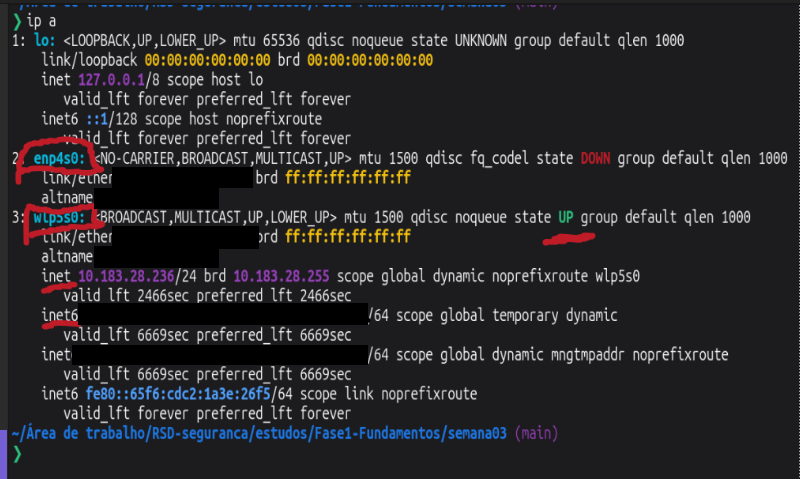
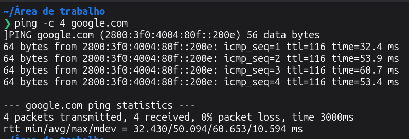
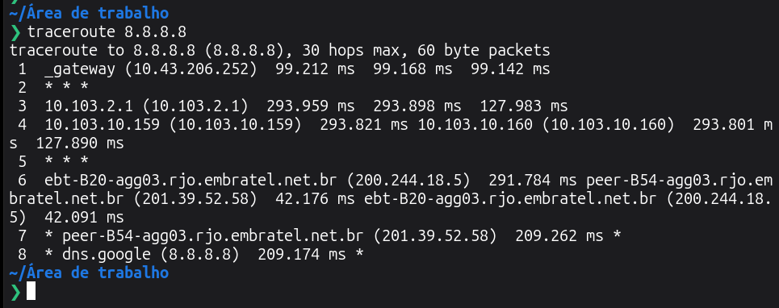
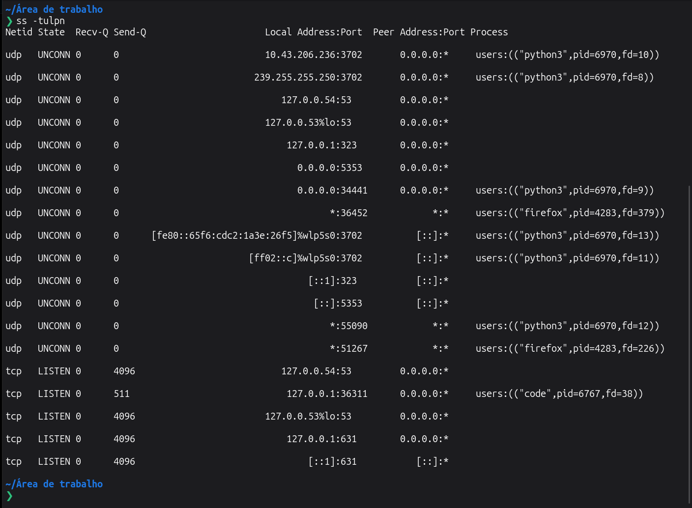

# 🌐 Semana 03 — Redes: OSI, TCP/IP, portas e captura de tráfego (diário de laboratório)

> Este repositório guarda só laboratórios e problemas resolvidos. A teoria foi estudada fora dele.

- **Fase:** Fase1-Fundamentos
- **Tema:** Redes: modelo OSI, TCP/IP, portas e protocolos
- **Observação:** semana feita antes da estrutura atual do repositório e reorganizada depois.

## Tópicos praticados
- Diagnóstico pela CLI: `ip a`, `ping`, `traceroute`, `ss -tulpn`
- Captura de pacotes com `tcpdump` e análise no Wireshark (arquivo `.pcap`)
- Conceitos aplicados na prática: camadas OSI e TCP/IP, endereçamento IPv4/IPv6, portas TCP/UDP, handshake de três vias

## Laboratórios e problemas
| Laboratório | Status | Link |
|---|---|---|
| Diagnóstico de rede pela CLI | ✅ concluído | [desafio](./desafios/diagnostico-de-rede-cli.md) |
| Captura de 100 pacotes com tcpdump | ✅ concluído | [desafio](./desafios/captura-de-trafego-tcpdump.md) |

## Evidências

Captura de pacotes: [`dia-05_tcpdump_trafego-laboratorio.pcap`](./capturas/dia-05_tcpdump_trafego-laboratorio.pcap)

## Arquivos
- Desafios: [`desafios/`](./desafios/)
- Capturas: [`capturas/`](./capturas/)
- Não há scripts nem logs nesta semana.

## O que tentei e errei
_(preencher)_

## Como resolvi
_(preencher)_

## Dificuldades
_(preencher)_

## Lições aprendidas
_(preencher)_
