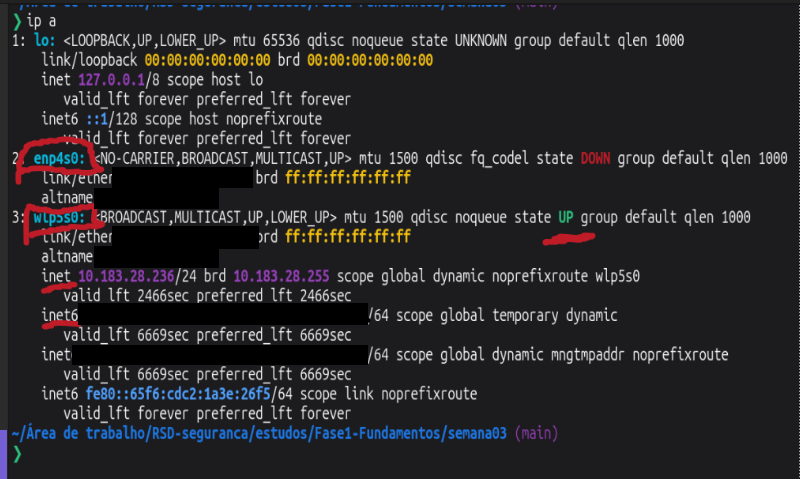
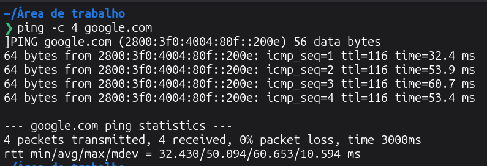
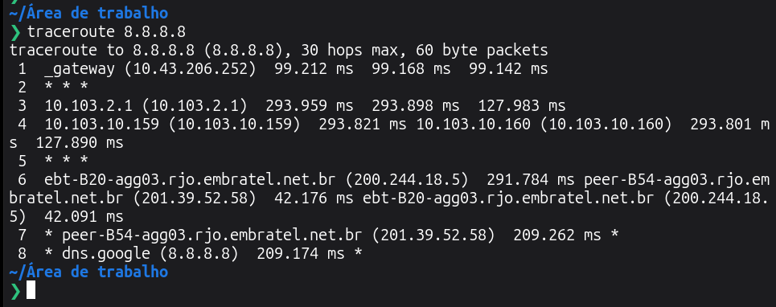
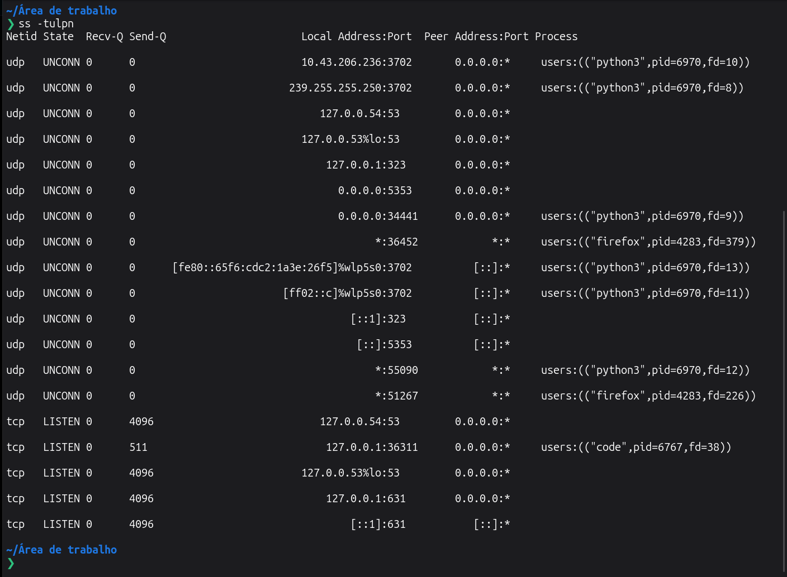

# Desafio — Diagnóstico de rede pela linha de comando (Semana 03)

## Enunciado
Identificar as interfaces de rede da máquina, testar conectividade e resolução de nomes, mapear a rota até um destino externo e listar quais portas estão em escuta e por qual processo.

_(Enunciado reconstruído a partir do README anterior da semana.)_

## Minha solução

| Comando | O que mostra | Captura |
|---|---|---|
| `ip a` | Interfaces locais: `lo`, `enp4s0` (sem cabo, DOWN) e `wlp5s0` (Wi-Fi, UP, com IPv4 privado) |  |
| `ping -c 4 google.com` | Resolução de nome e 4 respostas ICMP, 0% de perda, média de cerca de 50 ms |  |
| `traceroute 8.8.8.8` | Saltos do gateway local até `dns.google`, alguns saltos sem resposta (`* * *`) |  |
| `ss -tulpn` | Portas TCP/UDP em escuta e processos dono (`python3`, `firefox`, `code`), sem `sudo` |  |

Observação sobre o `ss`: sem `sudo` a coluna de processos só aparece para sockets do próprio usuário. Com `sudo` apareceriam também os dos serviços do sistema.

Critério de "concluído": os quatro comandos executados e a saída explicada em uma linha cada.
